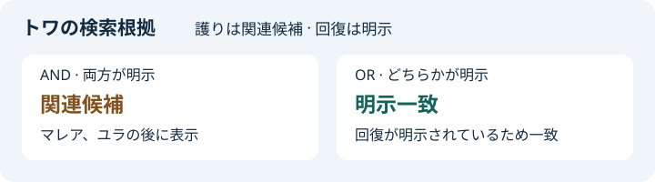

# 風綴りの群島 · 渡り手図鑑

[](https://github.com/rk-codefolio/character-atlas/actions/workflows/verification.yml)

架空ゲーム「風綴りの群島」の図鑑です。107人の渡り手を探し、スキルや育成値を確認できます。45件のコンテンツを掲載し、コメント・ビルド・攻略投稿、通報、管理者による対応を扱います。

**[Dockerで起動する](archipelago-app/README.md#dockerで起動する)** · [操作を試す](archipelago-app/README.md#試し方) · [構成図・仕様](docs/ARCHITECTURE.md) · [ドメイン一覧](docs/DOMAINS.md) · [Codexとの開発記録](docs/AI_DEVELOPMENT.md)

## 3分で見る検索

「護り」と「回復」を選び、ANDとORを切り替えると、トワの検索結果に表示される根拠が変わります。トワの技「夜渡りの灯」は回復を明示し、護りには関連候補として登録されています。



Dockerで起動したら、[AND検索](http://localhost:3000/search?term=guard&term=restore&mode=AND)と[OR検索](http://localhost:3000/search?term=guard&term=restore&mode=OR)を開いて比較できます。

[操作手順](archipelago-app/README.md#試し方) · [検索の実装](catalog-core/src/main/java/dev/characteratlas/application/search/CharacterCatalog.java) · [検索のテスト](catalog-core/src/test/java/dev/characteratlas/application/search/CharacterCatalogTest.java)

| プロジェクト | 担当 |
| --- | --- |
| [catalog-core](catalog-core/README.md) | Java 25 LTS・DDD。キャラクター、技、効果、検索根拠と検索ユースケース |
| [archipelago-app](archipelago-app/README.md) | Spring Boot・PostgreSQL・Flyway・Next.js。22のREST API、架空データ、図鑑・投稿・管理の画面 |

## Codexを使った開発

**使用ツール：OpenAI Codex**

このプロジェクトは、私が自然言語で作業を指示し、Codex が資料の照合、設計案の作成、コードの実装、JUnit テストの作成・実行、Docker での動作確認を担当する形で開発しました。私は要件と優先順位を決め、画面やコードをレビューして改善方針を決定しました。

私が工夫した点は、検索で迷ったときの扱いを決め、閲覧者が実際に操作して確認できる形にしたことです。

- **検索の根拠を順位に反映**。根拠が弱い候補も残し、明示された効果で条件を満たすキャラクターを先に表示します。
- **画面の役割を絞る**。提案で比重が大きかったイベントは調査資料として扱い、一覧・効果検索・詳細を主な導線にしました。一覧は図鑑順を初期値にし、比較表を設けず並べ替えに留めました。
- **同じ検索基盤で試せる形にする**。共通のJava基盤と架空データを扱うアプリを分け、実際の画面・API・DBをDockerで起動できるようにしました。

初回公開までの人間の作業時間は **約5時間**（対話履歴からの概算）です。[見積もりの内訳と対話の試行錯誤](docs/AI_DEVELOPMENT.md) · [公開ソースを使った分析事例](docs/WESNOTH_ANALYSIS.md)

**Codexコードレビュー実施済み**。初回公開時、機能拡張後、人間レビュー対応後に実施しました。[初回の結果](docs/AI_DEVELOPMENT.md#codexコードレビュー) · [第2回](docs/AI_DEVELOPMENT.md#codexコードレビュー第2回) · [第3回](docs/AI_DEVELOPMENT.md#codexコードレビュー第3回)

## PRごとの検証

PRとmainの更新時に、Javaの単体テスト、PostgreSQL統合テスト、合算行カバレッジ90%以上の検査、Next.jsのビルドを実行します。各実行の成果物からJUnitとJaCoCoのHTMLレポートを取得できます。[GitHub Actionsの実行結果](https://github.com/rk-codefolio/character-atlas/actions/workflows/verification.yml)

## 共通基盤のテスト

JDK 25がある環境では、リポジトリのルートから次のコマンドを実行できます。

```sh
cd catalog-core
./gradlew test
```
