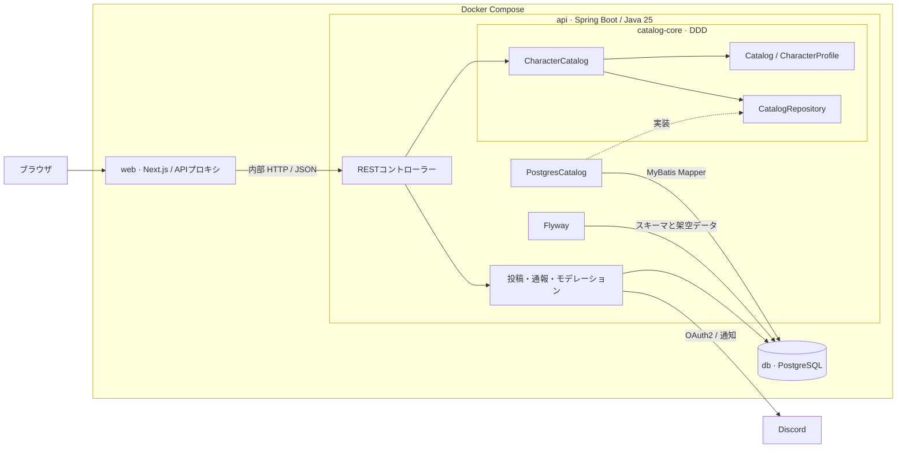

# 構成図と仕様

架空ゲーム「風綴りの群島」のデータ、Web画面、REST API、権限の構成です。[Dockerでの起動と試し方](../archipelago-app/README.md)

## システム構成

`catalog-core` はキャラクター・スキル・検索根拠のモデルと検索ユースケースを保持します。DB取得は `CatalogRepository` を境界に分離しています。 `archipelago-app` が実装を組み立て、REST APIとPostgreSQLアダプター、投稿やモデレーション、架空データ、Next.jsの画面を提供します。[共通基盤](../catalog-core/README.md) · [Gradleの接続](../archipelago-app/settings.gradle) · [Compose定義](../archipelago-app/compose.yaml)

## コンテキストと依存方向

各ドメインの責務、用語、実装の入口は [ドメイン一覧](DOMAINS.md) を参照してください。

図鑑はスキル・効果と検索根拠を管理します。投稿はコメント・ビルド・攻略の投稿内容と更新を扱います。モデレーションは通報・権限・監査ログを扱います。図鑑から投稿を参照する際は関連キャラクターの識別子だけを取得し、投稿の更新からは監査ポートへ記録します。

RESTコントローラーでHTTPを処理し、ユースケースで更新と監査をまとめます。投稿本文の制約はドメインで検証します。SQLは各コンテキストのインフラ層にあるMyBatis Mapperで扱います。Flywayが既存スキーマと架空データを管理します。

## 画面とユースケース

| 機能 | 振る舞い |
| --- | --- |
| 図鑑・詳細 | 107人。名前の部分一致、図鑑順と8項目の昇順・降順。属性・星航級バッジ、対象者のみ覚醒前後の切替。スキルCD、パッシブ、レベル別の効果、固有効果の説明 |
| 詳細検索 | 効果・CDの分類、役割、複数の関連コンテンツを選択。条件名を複数IDに束ね、AND／ORと根拠の優先度を適用 |
| コンテンツと投稿 | 常設・期間限定の45件。コメント、ビルド、攻略投稿。ビルドには47種の航海具・27種の航路紋・装具3枠。攻略投稿に関連キャラクターを複数設定 |
| 通報と管理 | 通報の重複を防いでDBに保存。Discord OAuth2を設定した管理者は、投稿編集・削除と通報対応が可能。オーナーは操作ログの閲覧と検索候補の編集が可能 |
| ゲーム仕様 | 一覧と20の詳細ページ。行動順、属性相性、付与率、装具と育成などの説明 |

## 検索ルール

明示された効果・タグと関連候補を保持します。ANDではすべて、ORではいずれかの条件を明示だけで満たす結果を先に表示します。残りの関連候補も表示し、各グループ内は図鑑順です。関連コンテンツの指定時は、各グループ内で投稿が紐づく渡り手を先に表示します。条件未選択では全件を対象にします。

名前は前後の空白を除き、Unicode正規化と小文字化をして照合します。ステータス順の欠損値は昇順・降順とも末尾、同値は図鑑順です。[検索の実装](../catalog-core/src/main/java/dev/characteratlas/application/search/CharacterCatalog.java) · [検索ルールのテスト](../catalog-core/src/test/java/dev/characteratlas/application/search/CharacterCatalogTest.java)

## REST API

Next.jsの同一オリジンプロキシが、次の22ルートをSpring Bootへ中継します。書き込みは設定したオリジンから受け付け、管理操作はセッションとロールで認可します。

| 用途 | メソッドとパス |
| --- | --- |
| 一覧・詳細 | `GET /api/characters`、`GET /api/characters/{id}` |
| 育成・効果 | `GET /api/characters/{id}/progress`、`GET /api/characters/{id}/effects` |
| 効果と検索 | `GET /api/terms`、`GET /api/search` |
| 投稿オプション | `GET /api/review-options`、`GET /api/search-contents` |
| 投稿 | `GET /api/posts`、`POST /api/posts`、`PUT /api/posts/{id}`、`DELETE /api/posts/{id}` |
| 通報 | `POST /api/posts/{id}/reports`、`GET /api/admin/reports`、`PUT /api/admin/reports/{id}` |
| 管理セッション | `GET /api/admin/session`、`GET /api/admin/discord/start`、`GET /api/admin/discord/callback`、`POST /api/admin/logout` |
| 管理操作 | `GET /api/admin/posts`、`GET /api/admin/logs`、`PUT /api/admin/search-contents/{id}` |

[検索API](../archipelago-app/src/main/java/dev/characteratlas/archipelago/catalog/presentation/CatalogController.java) · [投稿API](../archipelago-app/src/main/java/dev/characteratlas/archipelago/posting/presentation/ReviewPostController.java) · [REST統合テスト](../archipelago-app/src/test/java/dev/characteratlas/archipelago/ArchipelagoIntegrationTest.java)

## データの差し替え

初回の6人はV100、残る101人と育成・448種の効果説明・投稿例はV101で登録します。既存DBの更新には新しいFlywayマイグレーションを使います。コンテンツ名と装具の選択肢はJSON、肖像とゲーム仕様はNext.jsのファイルで管理します。[V101の架空データ](../archipelago-app/src/main/resources/db/migration/V101__voyager_atlas.sql) · [コンテンツと装具の設定](../archipelago-app/src/main/resources/archipelago-options.json) · [肖像](../archipelago-app/web/app/portrait.jsx) · [ゲーム仕様](../archipelago-app/web/app/game-rules/guides.js)
