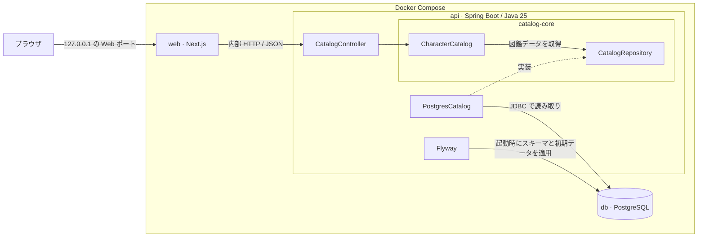

# 構成図と仕様

公開版「風綴りの群島」の構成と、画面・APIで確認できる振る舞いを記載します。[README](../README.md) · [Dockerでの起動と試し方](../portfolio-demo/README.md)

## システム構成

| 構成 | 担当 |
| --- | --- |
| `catalog-core` | キャラクター・スキル・効果のモデルと、名前検索、並べ替え、検索根拠の判定。データ取得の境界を `CatalogRepository` で定義する |
| `portfolio-demo` | Next.jsの画面、Spring Bootの読み取りAPI、PostgreSQLから読み込むアダプター、架空データの初期登録 |
| Docker Compose | Web・API・DBを起動する。ホストにはWebポートをループバックで公開し、APIとDBはCompose内で利用する |

公開アプリはGradleの複合ビルドで共通基盤を参照します。スキーマと架空データはFlywayで適用します。[共通基盤](../catalog-core/README.md) · [Gradleの接続](../portfolio-demo/settings.gradle) · [Compose定義](../portfolio-demo/compose.yaml)

## 画面仕様

| 画面 | 入力と表示 |
| --- | --- |
| 渡り手一覧 `/` | 名前の部分一致。初期値は図鑑順の昇順。図鑑順、速度、HP、攻撃力、防御力を昇順・降順で表示できる |
| 効果検索 `/search` | 効果・タグを複数選び、ANDまたはORで検索する。該当スキルと検索根拠を結果に表示する |
| 詳細 `/characters/{id}` | 属性、レア度、ステータス、スキル説明と効果を表示する。存在しないIDは404になる |

名前照合は前後の空白を除き、Unicode正規化と小文字化をしてから比較します。ステータスで並べ替えるとき、値がないキャラクターは昇順・降順とも末尾に置き、同値の場合は図鑑順で並べます。[検索と並べ替えの実装](../catalog-core/src/main/java/dev/characteratlas/application/CharacterCatalog.java)

## 効果検索の仕様

各スキルと検索条件の紐づけに、明示された効果、明示されたタグ、関連候補のいずれかを記録します。検索は明示と候補の両方を使って対象を絞り、明示だけで同じ条件を満たせるかどうかで表示順を決めます。

| 条件 | 検索対象に含める条件 | 先に表示する条件 |
| --- | --- | --- |
| AND | すべての選択項目に明示または候補の紐づけがある | すべての選択項目が明示されている |
| OR | いずれかの選択項目に明示または候補の紐づけがある | いずれかの選択項目が明示されている |
| 未選択 | 全員を表示する | 図鑑順 |

明示一致と関連候補の各グループ内は図鑑順です。たとえば「回復」が明示され「護り」が候補のトワは、両方を選ぶとANDでは関連候補、ORでは明示一致になります。[検索ルールのテスト](../catalog-core/src/test/java/dev/characteratlas/application/CharacterCatalogTest.java) · [架空データの登録](../portfolio-demo/src/main/resources/db/migration/V100__archipelago_catalog.sql)

## APIとデータ

| 内部API | 入力と結果 |
| --- | --- |
| `GET /api/characters` | `name`、`stat`、`direction` で一覧を取得 |
| `GET /api/characters/{id}` | IDで詳細を取得。存在しないIDは404 |
| `GET /api/terms` | 選択できる効果・タグを取得 |
| `GET /api/search` | `mode` と複数指定できる `term` で検索。未知の条件IDは400 |

キャラクターにステータスとスキルが紐づき、スキルと検索条件は中間テーブルで関連付けます。このテーブルが検索根拠を保持します。公開版の画面とAPIは、初期登録した図鑑データを閲覧・検索する範囲です。[API実装](../portfolio-demo/src/main/java/dev/characteratlas/archipelago/CatalogController.java) · [テーブル定義](../catalog-core/src/main/resources/db/migration/V1__character_catalog.sql)
