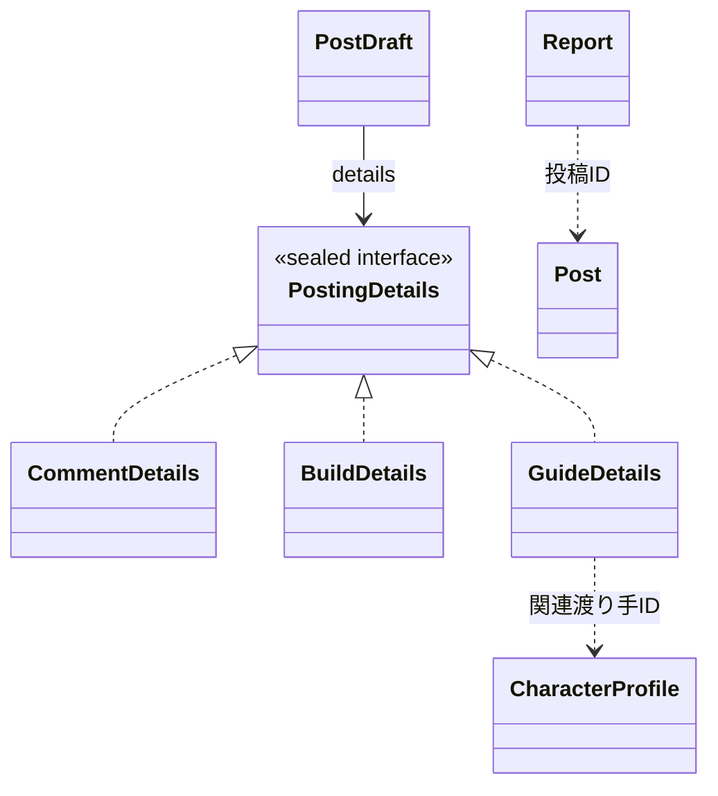

# ドメイン一覧

Character Atlas が扱う業務上の関心事を、**図鑑・検索、投稿、モデレーション**の3つに分けて説明します。画面や API の全体像は [構成図と仕様](ARCHITECTURE.md) を参照してください。

| ドメイン | 責務と主な用語 | 実装の入口 |
| --- | --- | --- |
| 図鑑・検索 | 渡り手、技、ステータス、検索語、検索根拠を扱う。根拠に応じて明示一致と関連候補を区別し、検索結果の順序を決める。 | [図鑑モデル](../catalog-core/src/main/java/dev/characteratlas/domain) · [検索ユースケース](../catalog-core/src/main/java/dev/characteratlas/application/CharacterCatalog.java) |
| 投稿 | コメント・ビルド・攻略の内容と更新を扱う。投稿種別に対応する詳細データを持ち、種別と詳細の組み合わせ、タイトル・本文の必須条件や長さを検証する。 | [投稿モデル](../archipelago-app/src/main/java/dev/characteratlas/archipelago/posting/domain) · [投稿サービス](../archipelago-app/src/main/java/dev/characteratlas/archipelago/posting/application/PostService.java) |
| モデレーション | 投稿への通報、管理操作の権限、監査ログを扱う。通報は重複を防いで保存し、管理者が対応する。操作ログの閲覧はオーナーの権限。 | [通報サービス](../archipelago-app/src/main/java/dev/characteratlas/archipelago/moderation/application/ReportService.java) · [管理 API](../archipelago-app/src/main/java/dev/characteratlas/archipelago/moderation/presentation/AdminController.java) |

## ドメイン間のつながり

- **図鑑・検索と投稿**：関連コンテンツを指定した検索では、投稿に紐づく渡り手の識別子を参照します。明示一致と関連候補の区分を保ったまま、それぞれの区分内で紐づく渡り手を先に表示します。参照の境界は [TaggedPostIndex](../archipelago-app/src/main/java/dev/characteratlas/archipelago/catalog/application/TaggedPostIndex.java) です。
- **投稿とモデレーション**：通報は投稿を対象にします。投稿の更新に伴う操作記録は、投稿サービスから [AuditLog](../archipelago-app/src/main/java/dev/characteratlas/archipelago/moderation/application/AuditLog.java) を通じて残します。

## コード上の配置

図鑑・検索の共通モデルと検索ユースケースは `catalog-core` にあります。`archipelago-app` の `catalog` はこの基盤を使い、画面向けの照会や PostgreSQL との接続を担当します。同じアプリの `posting` と `moderation` は、それぞれ投稿と管理の処理を持ちます。

この一覧の「ドメイン」は機能上の責務のまとまりです。Java の `domain` パッケージには図鑑と投稿のモデルがあり、モデレーションの通報や監査に関する型は `moderation/application` にあります。

## 投稿詳細の型と参照先

実線の矢印はフィールドの型、白抜き三角の矢印はインターフェースの実装を表します。ID のラベルが付いた点線は、別の領域のデータを識別子で参照する関係です。
